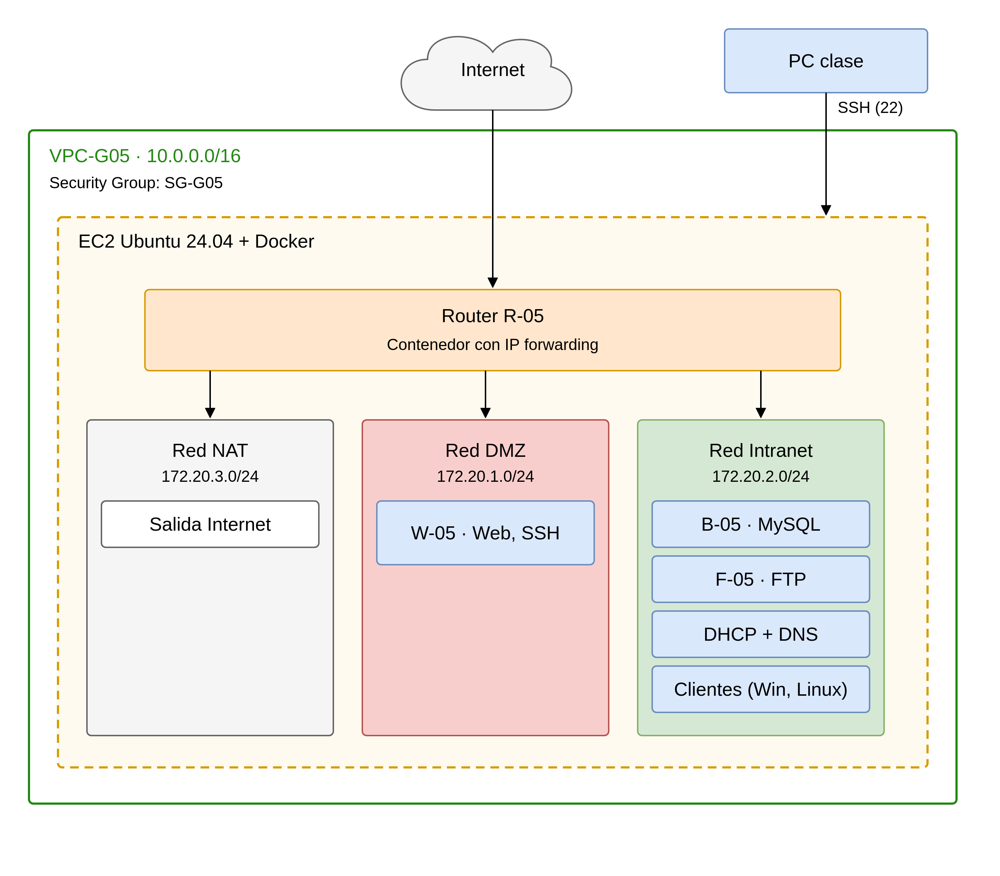

# Arquitectura

## 1. Objetivo
Desplegar la infraestructura para una aplicación multicapa (servidor web, base de datos, SSH, DHCP, DNS y FTP), con un router que conecta tres redes: DMZ, Intranet y NAT. Se incluyen dos equipos cliente, uno Windows y otro Linux.

## 2. Diagrama

## 3. Visión general
La infraestructura se despliega en Isard con **tres máquinas virtuales**:

- Una VM de servidor, `docker-05`, que ejecuta Docker y aloja todos los servicios como **contenedores**.
- Dos VMs cliente, una Ubuntu y una Windows.

Dentro de `docker-05`, el contenedor **R-05** actúa como router y conecta las redes NAT, dmz e intranet. Los servicios se reparten por redes según su función: el servidor web en la DMZ y el resto de servicios en la Intranet. Se accede al entorno desde el PC de clase mediante el visor de Isard.

## 4. Máquinas virtuales (Isard)

| VM | Sistema | Función | Redes |
|---|---|---|---|
| docker-05 | Ubuntu Server | Aloja Docker y todos los contenedores | NIC1: red Isard por defecto (NAT) · NIC2: red privada Intranet |
| Cliente Ubuntu | Ubuntu Desktop | Equipo cliente | Red privada Intranet |
| Cliente Windows | Windows | Equipo cliente | Red privada Intranet |

## 5. Contenedores (dentro de docker-05)

| Contenedor | Función | Red | IP |
|---|---|---|---|
| R-05 | Router con reenvío IP y NAT | NAT, dmz e intranet | 172.20.1.2 (dmz) · 192.168.20.2 (intranet) |
| W-05 | Servidor web y SSH | dmz | 172.20.1.10 |
| B-05 | Base de datos MySQL | intranet | 192.168.20.10 |
| F-05 | Servidor FTP | intranet | 192.168.20.11 |
| DHCP + DNS | Asignación de direcciones y resolución de nombres (`R-05` y `R`) | intranet | 192.168.20.12 |

## 6. Redes

| Red | Tipo | Subred | Función |
|---|---|---|---|
| NAT | Red por defecto de Isard (NIC1 de docker-05) | Asignada por Isard | Salida a Internet |
| dmz | Red Docker (bridge) | 172.20.1.0/24 | Servicios expuestos (servidor web) |
| intranet | Red Docker (macvlan sobre NIC2) | 192.168.20.0/24 | Servicios internos y clientes |

La red `intranet` usa macvlan sobre la segunda tarjeta de red de `docker-05`, conectada a una red privada de Isard. Así los contenedores de la intranet y las VMs cliente comparten la misma red.

Rango DHCP para los clientes: 192.168.20.100 - 192.168.20.200.

## 7. Flujo de comunicación
- Los **clientes** obtienen IP por DHCP y resuelven nombres con el DNS de la intranet.
- Para llegar al **servidor web** (DMZ), los clientes pasan por R-05.
- **W-05** consulta la base de datos de **B-05** a través de R-05.
- Todos los equipos salen a **Internet** por R-05, que hace NAT hacia la red de Isard.
- El **PC de clase** accede a las VMs mediante el visor de Isard.

## 8. Usuario común
Todos los sistemas (VMs y contenedores) tienen el usuario `bchecker`, como exige el enunciado.

## 9. Decisiones de diseño
- **Una VM con todos los contenedores:** reduce el consumo de recursos de Isard y permite reproducir el despliegue con ficheros de configuración guardados en el repositorio.
- **Router como contenedor:** simula el enrutamiento entre las tres redes dentro de la misma VM.
- **Clientes como VMs:** Docker en Linux no ejecuta contenedores Windows, y además los clientes deben ser equipos independientes.
- **DHCP y DNS en un mismo contenedor:** `dnsmasq` ofrece ambos servicios con poca carga.
- **Red intranet con macvlan:** permite que los clientes, que son VMs aparte, vean los contenedores de la intranet directamente.

## 10. Enlaces
- [Red](../red/README.md)
- [Servicios](../servicios/README.md)
- [Clientes](../clientes/README.md)
