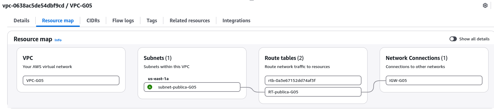

# Red

## 1. VPC y subredes

### Objetivo
Crear la red base en AWS para alojar la instancia con Docker.

### Pasos realizados
1. Creada la VPC `VPC-G05` con CIDR `10.0.0.0/16`.
2. Creada la subred `subnet-publica-G05` (`10.0.1.0/24`) con asignación automática de IP pública.
3. Creado y asociado a la VPC el Internet Gateway `IGW-G05`.
4. Creada la tabla de rutas `RT-publica-G05` con la ruta `0.0.0.0/0` hacia el IGW y asociada a la subred.

### Capturas

### Comprobación
El Resource map muestra la subred conectada a la tabla de rutas y al Internet Gateway.

### Problemas encontrados
(Apunta aquí lo que te falle, aunque sea poco.)
